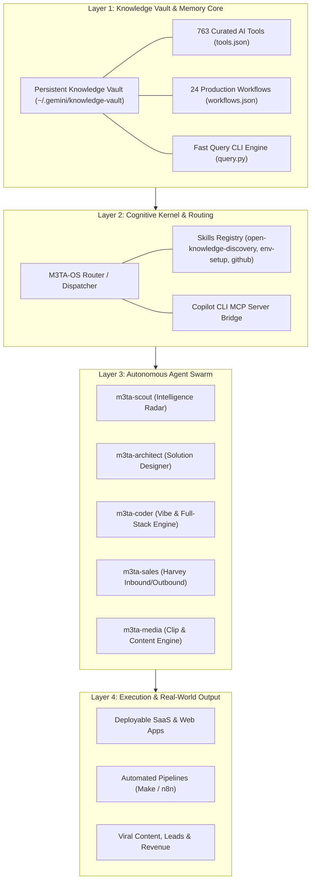

# M3TA-OS — The Intelligence Empire Blueprint

> **Vision:** Transform static AI tools, prompts, and workflows into an autonomous, self-evolving **Cognitive Operating System (M3TA-OS)** that continuously discovers intelligence, synthesizes solutions, and executes business operations through autonomous agent swarms.

---

## 1. System Architecture: M3TA-OS Stack

---

## 2. Autonomous Agent Swarm (The Fleet)

| Agent Role | Codename | Primary Function | Core Tools & Integrations |
| :--- | :--- | :--- | :--- |
| **Intelligence Radar** | `m3ta-scout` | Continuously monitors ProductHunt, GitHub Trending, arXiv, and short-form video releases to discover new AI tools, prompts, and frameworks. Ingests and scores them into the Vault. | Web scraper, Perplexity, GitHub API |
| **Solution Architect** | `m3ta-architect` | Takes any business goal (e.g. *"automate customer support and ticket routing"*) and queries the 763-tool database to design optimal architectural blueprints and tool stacks. | `open-knowledge-discovery`, LLM Planner |
| **Vibe / Autonomous Coder** | `m3ta-coder` | Scaffolds and writes end-to-end full-stack applications, CLI utilities, and integrations using terminal harnesses and code models. | Copilot CLI, Claude Code, Cursor, v0 |
| **Growth & Media Engine** | `m3ta-media` | Takes long-form videos/docs and automatically generates short-form clips, LinkedIn threads, and interactive newsletters. | MoneyPrinterTurbo, Opus Clip, ElevenLabs |
| **Autonomous Sales Agent** | `m3ta-sales` | Ingests leads from landing pages, scores ICP fit via LLM reasoning, and conducts multi-channel automated follow-up. | Harvey agent, Make.com, DeepSeek, Resend |

---

## 3. High-Leverage Automations to Deploy

### 1. "Reel-to-Code" Autonomous Ingestion Pipeline
- **Trigger:** A new AI tutorial or workflow video is published (YouTube / Instagram / TikTok).
- **Execution:**
  1. `m3ta-media` extracts the audio transcript and key visual frames.
  2. The Document-to-Topic parser identifies prerequisite steps, code snippets, and prompts.
  3. `m3ta-coder` clones the referenced GitHub repo, creates a smoke test in a sandbox, and verifies that the workflow actually works.
  4. The verified guide is instantly published to your live platform and committed to the Knowledge Vault.

### 2. Copilot CLI Knowledge Vault MCP Server
- **Objective:** Give your command line (`copilot-cli-tmw`) direct native tool access to the entire 763-tool directory and 24 master workflows.
- **Implementation:**
  - Create a lightweight MCP server (`m3ta-vault-mcp`) exposing tools:
    - `vault_search_tools(query, category, pricing)`
    - `vault_get_workflow(topic_id_or_keyword)`
    - `vault_suggest_stack(project_description)`
  - Run Copilot CLI in terminal: Copilot can instantly say: *"For video lip-sync, the best free tool in our vault is Open Generative AI with Wan AI"* and generate the exact setup scripts.

### 3. Self-Updating Knowledge Vault Cron
- Weekly cron job running inside the background to check dead tool URLs, re-index pricing changes, and fetch latest release notes from GitHub repositories.

---

## 4. Immediate Concrete Upgrades Applied

1. **Persistent Vault Storage:**
   - Datasets (`tools.json`, `tools.csv`, `workflows.json`, `logos.json`, `summary.json`) are permanently archived at:
     `/home/antigravity/.gemini/knowledge-vault/maitis-ai/`
2. **Persistent Query Engine:**
   - Lightning-fast CLI query script installed at:
     `/home/antigravity/.gemini/knowledge-vault/maitis-ai/query.py`
3. **Activated Skill:**
   - `open-knowledge-discovery` skill configured at:
     `/home/antigravity/.gemini/skills/open-knowledge-discovery/SKILL.md`
4. **Interactive Command Center:**
   - Web application artifact with live admin document-to-topic converter ready in:
     `maitis_platform.html`
