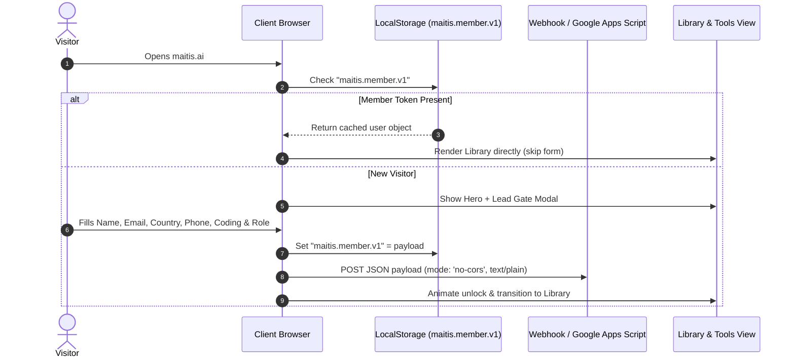
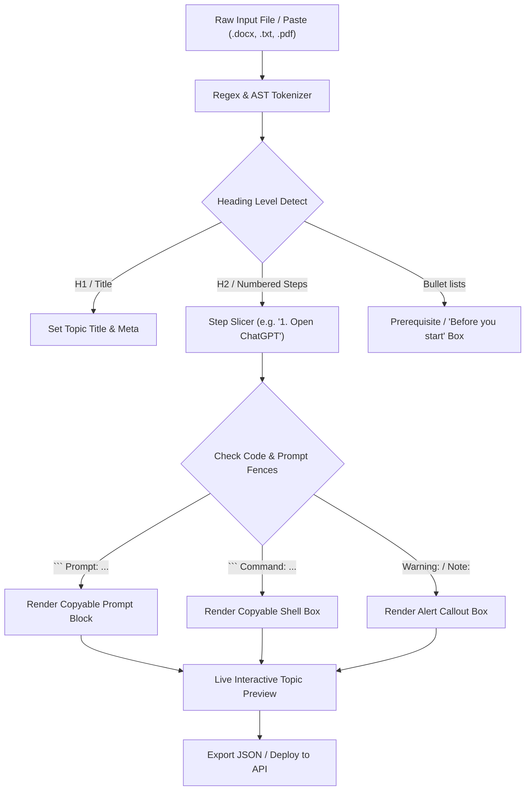

# Maitis AI — Architectural & Technical Blueprint

A comprehensive reverse-engineering and architectural analysis of [maitis.ai](https://maitis.ai), an AI workflow library and directory built for high conversion, zero build-step edge delivery, and rapid content publishing.

---

## 1. Executive Summary & Core Philosophy

| Metric / Dimension | Specification in Maitis AI | Production Recommendation |
| :--- | :--- | :--- |
| **Architecture** | Single-file monolith (738 KB self-contained HTML/CSS/JS) | Jamstack (Next.js / Astro + Tailwind + Cloudflare Workers) |
| **Catalog Scale** | 763 AI Tools across 26 categories, 24 curated video workflows | PostgreSQL (Prisma/Drizzle) + pgvector semantic search |
| **User Onboarding** | Client-side gating via `localStorage["maitis.member.v1"]` | Supabase Auth / Clerk / NextAuth with JWT session |
| **Lead Capture** | Plain-text HTTP POST (`no-cors`) to Google Apps Script / Webhook | Serverless API route with rate-limiting, CRM sync (HubSpot/Customer.io) |
| **CMS / Admin** | Client-side `#admin` hash routing with doc parser | Headless CMS (Sanity / Strapi) or custom admin dashboard |
| **Logos & Assets** | 665 pre-baked inline SVG/base64 favicons + Google Favicon fallback | Cloudflare Images / WebP CDN with domain-based favicon proxy |

Maitis AI is designed with an **ultra-lightweight, zero-build edge architecture**. Rather than running a traditional backend with server-side rendering or heavy hydration frameworks, the site delivers a single pre-baked bundle. This results in:
- Instant first-contentful paint (FCP) and near-zero server infrastructure costs.
- High resilience: can be hosted anywhere (Vercel, Cloudflare Pages, S3/CloudFront, GitHub Pages).
- Rapid lead generation: no login friction—a simple client-side form captures visitor profile data and unlocks the complete library.

---

## 2. Lead Capture & Client-Side Gating Architecture

### Lead Gating Lifecycle


### Lead Payload Schema
When a user signs up, the client executes `saveLead()` dispatching a structured JSON payload:
```typescript
interface MaitisLeadPayload {
  name: string;
  email: string;
  country: string;
  countryCode: string;
  phone: string; // E.164 e.g. "+14155552671"
  knowsCoding: boolean;
  role: "Student" | "Working professional" | "Founder or business owner" | "Freelancer or consultant" | "Content creator" | "Something else";
  experience: "Not working yet" | "Less than 2 years" | "2 to 5 years" | "5 to 10 years" | "More than 10 years";
  notifyNewResources: boolean;
  newsletter: boolean;
  source: {
    utm_source?: string;
    utm_medium?: string;
    utm_campaign?: string;
    utm_content?: string;
    utm_term?: string;
    src?: string;
    referrer: string;
    code?: string;
  };
  joinedAt: string; // ISO 8601 e.g. "2026-11-14T20:33:00Z"
}
```

> [!NOTE]
> **Why `no-cors` & `text/plain`?**
> The form submits directly from the browser to Google Apps Script or Zapier webhooks. Sending as `text/plain` avoids browser CORS preflight (`OPTIONS` requests), enabling serverless endpoint integration without configuring custom CORS headers.

---

## 3. Data Schema & Catalog Structure

### 3.1 AI Tools Catalog (763 Tools)
Each tool in the directory follows a normalized, search-optimized structure:
```typescript
interface AITool {
  id: string;               // Unique slug (e.g., "10web", "cursor", "v0")
  name: string;             // Display name
  category: string;         // Primary category (26 taxonomy nodes)
  tag: string;              // Punchy 3-5 word subtitle ("AI WordPress builder")
  description: string;      // 1-2 sentence functional summary
  pricing: string;          // Human-readable pricing ("Free plan available", "$20/mo")
  priceType: "free" | "freemium" | "paid"; // Filter facet
  url: string;              // Affiliate / direct tool URL
  domain: string;           // Domain used for favicon service ("10web.io")
  keywords: string;         // Tokenized keywords for sub-millisecond fulltext search
  order?: number;           // Sorting weight
  live?: boolean;           // Active status toggle
}
```

### Category Breakdown (Top Categories)
- **AI Agents & Automation**: 90 tools (11.8%)
- **Productivity & Notes**: 78 tools (10.2%)
- **Video Generation**: 72 tools (9.4%)
- **Marketing & Sales**: 49 tools (6.4%)
- **Chatbots & Assistants**: 44 tools (5.8%)
- **Image Generation**: 36 tools (4.7%)
- **SEO & AI Search**: 35 tools (4.6%)
- **Coding & Development / No-Code**: 68 tools combined (8.9%)

### 3.2 Workflow & Guide Topics (24 Master Topics)
Workflows are structured around actionable short-form video lessons with step-by-step guidance, copyable prompts, and tool links:
```typescript
interface TopicItemSteps {
  type: "steps";
  label: "Step-by-step guide";
  steps: Array<{
    title: string;          // Step heading ("Load your resume and map roles")
    text: string;           // Instructions containing markdown prompts:
                            // ``` Prompt 1: Recruiter map\n...\n```
  }>;
}

interface TopicItemTool {
  type: "tool";
  label: string;            // Tool name e.g. "ChatGPT", "Harvey"
  url?: string;
}

interface TopicItemGuide {
  type: "guide" | "template";
  label: string;
  url: string;
}

interface MaitisTopic {
  id: string;               // e.g. "019" or slug
  date: string;             // YYYY-MM-DD
  title: string;            // Topic title
  category: string;         // Topic category
  summary: string;          // Summary excerpt
  live: boolean;
  coverUrl?: string;        // Hero thumbnail
  items: Array<TopicItemSteps | TopicItemTool | TopicItemGuide>;
  updatedAt: string;
}
```

---

## 4. Document-to-Topic Conversion Pipeline

The Maitis Content Portal (`/#admin`) includes a parser that converts unstructured documents (Word `.docx`, Markdown, Google Docs text) into structured topics:



---

## 5. Modernization & Production Blueprint

If rebuilding or scaling this platform into a SaaS or modern community application, the recommended stack is:

1. **Frontend & Framework**:
   - **Next.js (App Router) + Tailwind CSS + shadcn/ui**: Server-side rendering for SEO on all 763 tool pages, instant client search using `@tanstack/react-table` or `minisearch`.
2. **Database & ORM**:
   - **PostgreSQL on Supabase or Neon** with **Drizzle ORM**.
   - Embeddings on tool descriptions and prompts using `text-embedding-3-small` with `pgvector` for natural-language search (e.g., *"tools that transcribe meetings and generate Jira tickets"*).
3. **Authentication & RBAC**:
   - Replace localStorage gating with **Clerk** or **Supabase Auth** (passwordless magic links or Google One-Tap).
   - Roles: `member`, `pro_member` (unlocking private workflows), `editor`, `admin`.
4. **Automated Content Sync**:
   - Hook to YouTube / Instagram Reels API: when a new video is published, a background agent extracts the transcript, runs an LLM step-extractor, creates a draft topic in the DB, and alerts editors via Discord/Slack.
